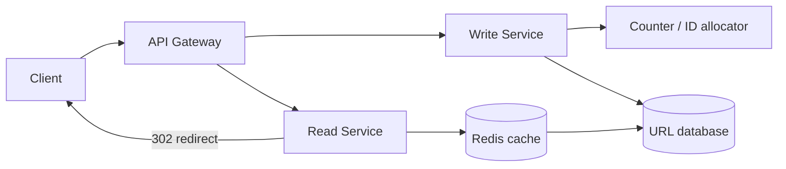
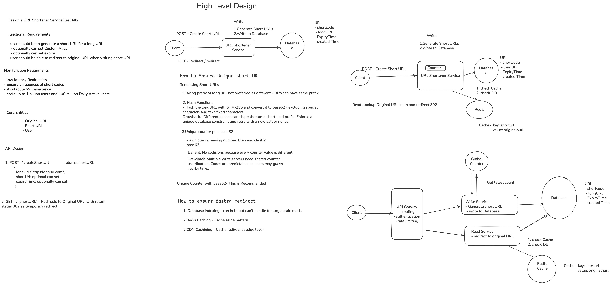

# URL Shortener — High-Level Design


## 1. Problem statement

Build a service that accepts a long URL and returns a shorter URL. When someone visits the short URL, the service looks up the mapping and redirects them to the original URL. The main challenge is serving redirects quickly while keeping short codes unique.

### Scope and assumptions

- Custom aliases and a caller-specified expiration date are optional features; every link receives a default expiration when the caller omits one (the default duration is a product/configuration choice).
- Authentication, account management, and click analytics are out of scope for the basic design.
- Use HTTP `302` when redirects must continue passing through the service, such as when links can expire or click tracking is required. `301` can be considered when permanent browser caching is acceptable.

## 2. Requirements

### Functional requirements

1. Users can submit a long URL and receive a shortened URL.
2. Links expire after the configured default timespan; users can optionally choose a custom alias or provide a different expiration date.
3. Users are redirected to the original URL when visiting the short URL.

### Out of scope

- Authentication and account management.
- Click analytics.
- Advanced spam detection and malicious URL filtering.

### Non-functional requirements

- **Uniqueness:** every short code maps to exactly one long URL.
- **Latency:** redirect in under 100 ms.
- **Availability:** target 99.99% availability; prioritize availability over strong consistency for redirect reads where appropriate.
- **Scale:** support about 1 billion stored short URLs and 100 million daily active users.
- **Read-heavy workload:** assume roughly 1,000 redirects per new link created; optimize the read path accordingly.

## 3. Capacity estimates (illustrative)

State assumptions explicitly in an interview; revise them if the interviewer provides numbers.

Illustrative target: 1 billion stored mappings and 100 million daily active users. The source design uses an approximate 1,000:1 redirect-to-create ratio; clarify actual traffic and peak factors with the interviewer.

- At roughly 500 bytes per record, 1 billion mappings require about 500 GB before replication and backups.
- One example write assumption is 100,000 new links per day (about 1.2 writes/second on average); read QPS depends on the redirect-to-create ratio and traffic distribution.
- Read traffic is highly skewed: a small number of popular links may receive a large fraction of requests. Cache hot mappings close to users.

These are sizing anchors, not guarantees. Confirm assumptions and peak traffic with the interviewer.

## 4. Core entities and data model

### Link

| Field | Purpose |
| --- | --- |
| `code` (primary key) | Public short code, unique across the service |
| `destination_url` | Canonical destination URL |
| `created_at` | Creation timestamp |
| `expires_at` | Expiration timestamp, set from the default lifetime unless overridden |
| `created_by` (optional) | Creator identifier if ownership is later added |

### User (optional, out of scope)

Represents the creator if authentication and account management are added later.

### Storage choice

A relational database such as PostgreSQL is a reasonable starting point: short code is the primary key, so lookups use an index instead of scanning the table. A distributed key-value store is another option if point-read scale or partitioning needs justify it.

- **Mapping store:** keyed/indexed by `code`, optimized for point lookups.
- **Optional extensions:** owner indexes and analytics storage can be added if those features enter scope.

Do not choose a database by fashion; explain access patterns, uniqueness requirements, consistency needs, and operational trade-offs.

## 5. API design

### Create a link

```http
POST /urls
Content-Type: application/json

{
  "long_url": "https://www.example.com/some/very/long/url",
  "custom_alias": "optional_custom_alias",
  "expiration_date": "optional_expiration_date"
}
```

```http
201 Created
{
  "short_url": "https://short.example/abc123"
}
```

`custom_alias` and `expiration_date` are optional. When `expiration_date` is omitted, apply the configured default expiration. Return a conflict if a requested alias is already in use and a client error for an invalid URL.

### Resolve a link

```http
GET /{short_code}
```

Return `302 Found` with a `Location` header containing the original URL. Return `410 Gone` for an expired link and `404 Not Found` for an unknown code.

## 6. Short-code generation

The code must be short, unique, URL-safe, and cheap to look up.

### Counter encoded as Base62

1. Allocate a unique numeric ID from an atomic counter.
2. Encode the number using `[0-9a-zA-Z]` (Base62) to produce a compact code.
3. Store the mapping under a unique constraint before returning the short URL.

Six Base62 characters provide about 56.8 billion codes; seven provide about 3.5 trillion. A billion IDs need about six characters. A global counter is simple but requires coordination and produces predictable codes. Redis `INCR` or a database sequence can allocate IDs atomically; batching ranges reduces counter calls. If Redis fails over and reuses an ID, the database unique constraint must catch the collision and the writer must allocate another ID. Obfuscating sequential IDs can reduce casual enumeration, but is not access control.

### Hash-based and random codes

Hashing the URL with SHA-256 is deterministic: identical input produces the same digest. A shortened/truncated hash can collide, so enforce uniqueness in storage and retry with a nonce or salt when necessary. The same URL always yielding the same code also implies deduplication; that may be undesirable when separate links need different expiry or aliases. Canonicalize URLs only if equivalent URL forms should map to the same key. Encode digest bytes into a URL-safe alphabet such as Base62; Base64's `+` and `/` are awkward in path segments. Random tokens are another option and also require uniqueness checks and collision retries.

### Custom aliases (optional)

Normalize and validate the requested alias, reserve it atomically with a unique constraint, and reject reserved/system words. The uniqueness check must happen at the authoritative store, not only in an application-side pre-check. Apply stricter rate limits and abuse checks to custom aliases.

## 7. High-level architecture



### Responsibilities

- **API gateway:** route create and redirect requests to the appropriate service.
- **Write service:** validate the URL, generate a unique code, and save the mapping.
- **Counter/ID allocator:** provide unique IDs to horizontally scaled writers; optionally allocate batches of IDs.
- **Read service:** look up the code, check expiration, and return an HTTP redirect.
- **Database:** durable source of truth with an index/primary key on short code and a uniqueness constraint.
- **Redis cache:** cache popular `short_code → long_url` mappings to reduce database reads and redirect latency.

## 8. Main flows

### Create flow

1. Client sends the long URL and optional alias/expiry.
2. Write service validates the URL.
3. Generate a short code (or validate and reserve the requested alias).
4. Persist `short_code → long_url`, creation time, and optional expiry. The database uniqueness constraint is the final collision check.
5. Return the short URL only after persistence succeeds.

### Redirect flow

1. Browser requests `GET /{short_code}`.
2. Read service checks Redis; on a miss, it looks up the short code using the database index and populates the cache.
3. Check whether the link has expired. Return `410 Gone` if it has; otherwise return `302 Found` with the original URL in `Location`.
4. Set cache TTL no longer than the remaining link lifetime. A periodic cleanup job may delete expired rows; expiration checks must still happen on reads.

## 9. Scaling, availability, and consistency

- **Read scaling:** index the database by short code to avoid table scans; use Redis to cache popular mappings. Cache-aside: read cache first, fetch from database on a miss, then populate cache.
- **Cache expiry:** set TTL to the lesser of the normal cache TTL and remaining link lifetime. Expiration is checked by the read service; a background job can clean up expired rows.
- **Read/write split:** scale read and write services independently because redirects greatly outnumber link creations.
- **Database:** with approximately 100,000 creates per day and around 500 bytes per row, a relational database such as PostgreSQL can be a reasonable starting point. Replicas/backups improve availability; shard only when measured capacity requires it.
- **Partitioning:** if the data outgrows a single database, partition/shard mappings by short code.
- **Hot keys:** popular links are likely to dominate reads; caching absorbs much of this load.
- **Counter scaling:** use atomic increments and optionally preallocate disjoint batches of IDs to writer instances. In multiple regions, allocate non-overlapping ranges or use a globally unique ID strategy.
- **Failure behavior:** if Redis is unavailable, read from the database. If the counter service fails, link creation may pause while redirects continue. Replicate and back up the database.
- **Consistency:** a newly created mapping should be visible to redirect reads. Availability can take priority over strict consistency for cached reads, but code uniqueness must be enforced at write time.

## 10. Security, privacy, and abuse

- Validate URL syntax and allow only `http` and `https` schemes.
- Sequential codes are predictable and can be enumerated. Consider obfuscation or random/hash-based codes if this is a concern; neither makes a public link private.
- Rate limiting and malicious-URL detection are valuable production extensions, but advanced abuse prevention is outside the basic interview scope.

## 11. Observability and operations

Track create/redirect request rates, success and error rates, redirect latency, cache hit rate, database read/write latency, counter allocation failures, and expired-link responses. Alert on redirect availability/latency, database saturation, cache failures, and counter problems.

## 12. Key trade-offs to explain

| Decision | Option A | Option B | Considerations |
| --- | --- | --- | --- |
| Code generation | Sequential ID + Base62 | Random token | Sequential is compact and collision-free with an allocator but guessable; random is harder to enumerate but needs collision retries and enough entropy. |
| Redirect status | `301` | `302` | `301` can improve caching but is sticky; `302` supports changes and moderation more easily. |
| Cache policy | CDN/long TTL | Regional/short TTL | Long TTL lowers cost/latency but makes disable or updates slower to propagate. |
| Data consistency | Strong global writes | Regional eventual replication | Strong uniqueness/read-after-write costs latency; eventual replication needs conflict handling. |
| Storage | Relational DB | Distributed key-value store | Relational is a simple starting point; key-value storage supports high-volume point lookups and horizontal partitioning. |
| Database sizing | One database | Sharded databases | Start with one appropriately sized database; add shards when measured data or throughput needs it. |

## 13. Interview walkthrough

1. Confirm core requirements and clarify whether custom aliases and expiry are in scope.
2. State targets: unique codes, under 100 ms redirects, 99.99% availability, and the expected scale.
3. Call out the read-heavy workload and estimate storage and request rates.
4. Define `POST /urls`, `GET /{short_code}`, and the `short_code → long_url` mapping.
5. Compare hash-based codes with counter + Base62; explain collision and uniqueness handling.
6. Draw create and redirect flows, including database index and cache lookup.
7. Explain read/write service scaling, counter coordination, cache expiry, and database failover.

## 14. Five-minute review

- **Core lookup:** `short_code → destination URL`; optimize the redirect path for reads.
- **Requirements:** create short links, redirect to original URLs, optional aliases/expiry; target unique codes, under 100 ms redirects, 99.99% availability, 1B URLs, and 100M DAU.
- **Read/write ratio:** redirects greatly outnumber creates (illustrative assumption: around 1,000:1), so optimize reads with an indexed lookup and cache.
- **APIs:** `POST /urls` creates; `GET /{short_code}` redirects with `302`.
- **Code options:** SHA-256 gives deterministic hashes but shortened codes can collide; a counter encoded in Base62 gives unique IDs with an atomic allocator but needs coordination and can be predictable. Enforce uniqueness in the database either way.
- **Redirect:** cache lookup → database index on miss → expiration check → `302 Location`; return `410 Gone` for expired links.
- **Scale:** separate read and write services; cache popular mappings; batch counter ranges across writers; replicate/back up the database.
- **Reliability:** if cache fails, fall back to the database; if the counter fails, link creation may pause while reads continue.
- **Expiration:** ensure cache TTL does not exceed remaining link lifetime; optionally clean expired rows in the background.

### Common interviewer follow-ups

- **What if two requests choose the same code?** Atomic unique insert; retry generated codes, return conflict for a custom alias.
- **How do you handle a viral link?** Edge/CDN caching, regional caches, request coalescing, and protection of the origin store.
- **How do you prevent expired links from redirecting from cache?** Set cache TTL to no longer than remaining lifetime and check expiration on cache misses/reads; a cleanup job can remove old records.
- **Can codes be private?** Randomness reduces guessing but does not provide access control. Use authentication or a separate unguessable secret with explicit access semantics.

## 15. Final Design



